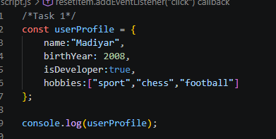
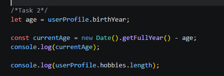
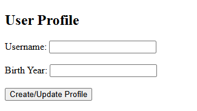
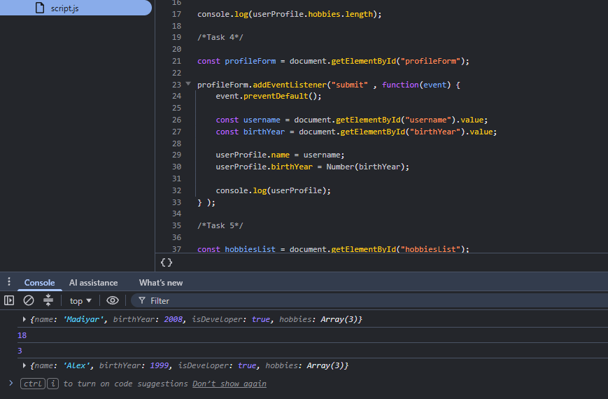
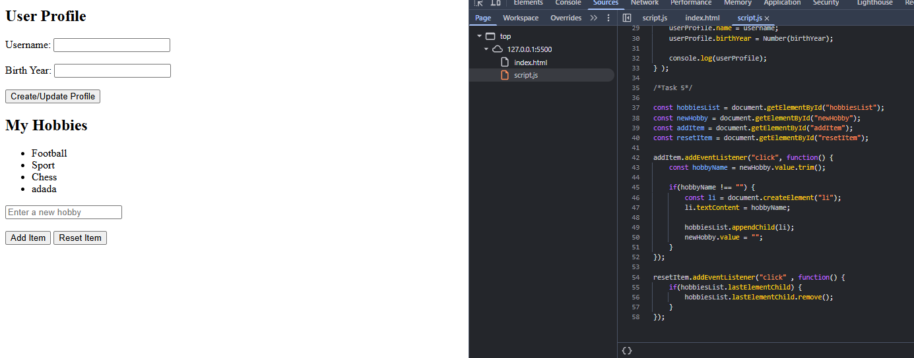

# Assignment 5 - JavaScript Basics (DOM Manipulation & Events)

## Student Information
- **Name:** Korganbek Madiyar
- **Group:** IT-2501

## Objective
The objective of this assignment is to learn JavaScript basics, including objects, data types, arithmetic operations, event handling, and DOM manipulation.

## Part 1: Profile Object, Data Types & Arithmetic

### Task 1: The Personal Info Object
Created a `userProfile` object containing a name, birth year, developer status, and hobbies array.

### Task 2: Arithmetic Calculations
Calculated the user's current age dynamically and counted the number of hobbies using JavaScript.

## Part 2: Form Input & Event Responses

### Task 3: HTML Form Setup
Created an HTML form with Username and Birth Year input fields and a Create / Update Profile button.

### Task 4: Event Listener
Added a submit event listener to retrieve user input and update the `userProfile` object.

## Part 3: DOM List Manipulation

### Task 5: Creating & Removing Elements
Created a hobbies list with Add Item and Remove Item buttons. JavaScript dynamically adds new list items and removes the last item.

## Conclusion

In this assignment, I learned how to work with JavaScript objects, data types, and arithmetic operations. I also practiced handling form submissions, using event listeners, and manipulating HTML elements through the DOM. The project helped me understand how JavaScript makes web pages interactive by allowing users to update profile information and add or remove items from a list.